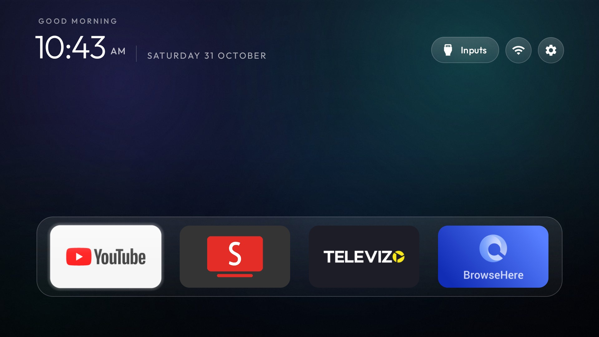
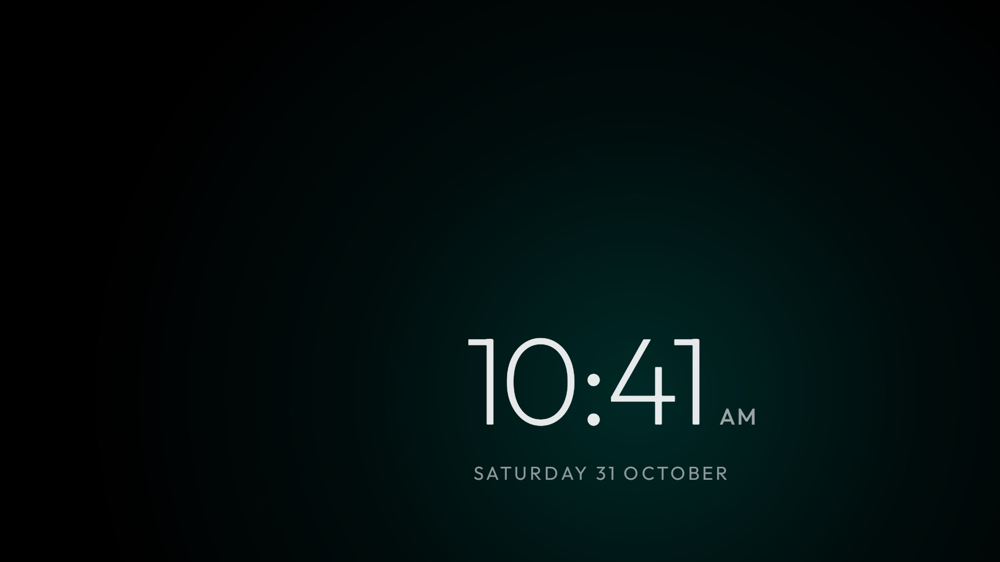

# CleanYourTV on a Haier MatrixTV DE

This branch is [CleanYourTV](https://github.com/Gathin23/cleanyourtv) plus one launcher change, tested on a real TV.

| | |
|---|---|
| **TV** | Haier MatrixTV DE (HR9676EUF, `omonia`, MediaTek) |
| **OS** | Google TV 14, firmware `UKN2.241219.053` |
| **Tested** | 31 October 2026, on one set, with the real remote, across reboots. Same-day test, not a long soak |
| **Works** | Debloat, launcher as Home, cinematic look, Open on start after a boot and after a power-button wake |





## What is different from upstream

`launcher/app/src/main/java/com/gathin/tvhome/MainActivity.java`: the app picked under **Open on start** also opens
when the screen comes back on. The remote's power button is a light sleep on this set, with no reboot, so upstream
opens the app only after a full restart. This also applies when the TV slept on an HDMI input.

## Install

From the repo root, with the TV's IP in `TV_HOST` and network ADB on:

```bash
tools/disable.sh docs/haier-matrixtv-de/debloat.txt
launcher/build-and-install.sh
tools/theme.sh docs/haier-matrixtv-de
```

Then hold OK on **Settings** on Home, choose **Launcher settings → Open on start**, and pick the app.

`config.json` is the owner's: edit `dock_apps` and `hidden_apps` for your own apps. Set `animations` back to `true`
only if you accept the cost: with animations on, 49% of frames were late moving along the dock; with them off, none.

## Quirks on this firmware

- Before disabling setupwraith, check `dumpsys wifi | grep -o 'cname=[^ ]*'`. It owned one saved network here, which
  was forgotten first. The network in use belonged to the system.
- Netflix comes back enabled at boot, so `pm disable-user` does not stick. It is hidden from Home with `hidden_apps`.
  Its background running was blocked with `cmd appops`; that was not checked across a reboot.
- Port 5555 and Wireless debugging both close at every reboot, so each full start needs a new `adb pair` code.
- `com.cltv.hybrid` and `com.cltv.mal` ship disabled here. Live TV is `com.mediatek.tv.oneworld.tvcenter`.

## Undo

```bash
tools/restore.sh docs/haier-matrixtv-de/debloat.txt com.google.android.apps.tv.launcherx
```
